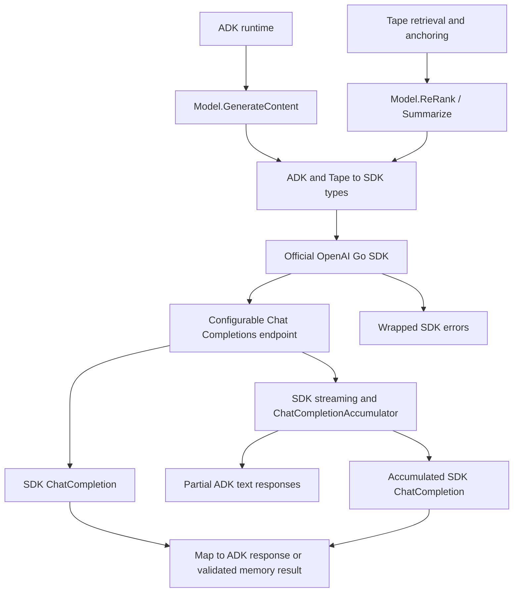

# OpenAI-compatible provider

## Specification

`pkg/provider/openai` integrates OpenAI-compatible Chat Completions with the ADK
runtime and Tape retrieval features. The official open-source
[`github.com/openai/openai-go/v3`](https://github.com/openai/openai-go) SDK owns
wire types, HTTP requests, authentication, API errors, retries, SSE parsing, and
stream accumulation. The provider contains the translation between SDK, ADK,
and Tape interfaces.

`NewModel(apiKey, modelName, ...option.RequestOption)` returns a model implementing
`model.LLM`, `llm.Model`, and `llm.Summarizer`. The default model is `gpt-4o-mini`;
a nonempty request model overrides the configured name for content generation.
Empty credentials and nil options are rejected. SDK options are applied after
provider defaults, so callers can configure base URL, HTTP client, timeouts, and
retries using the SDK's own API.

The provider defaults to `https://api.openai.com/v1`, a two-minute request timeout,
and zero retries. It passes contexts directly to SDK requests. Responses and
streams are closed by the SDK; the provider defers stream closure so stopping
iteration early also releases the response body. SDK API errors are wrapped with
operation context and remain accessible as `*openai.Error` through `errors.As`.

Generation translates system instructions, user and model text, function calls,
function responses, function declarations, calling mode and allowed names,
optional sampling controls, stop sequences, JSON object output, and output
limits. Output limits use the SDK's `MaxCompletionTokens`. Function parameter
schemas retain JSON Schema constraints, with GenAI type names normalized to
lowercase. Converted messages are forwarded without filtering tool responses;
conversation validation belongs to the caller or API. Thought parts are skipped. Other non-text parts, unsupported content
roles, and non-function tools return errors.

Non-streaming generation maps the first SDK choice to a complete ADK response.
Streaming uses `Chat.Completions.NewStreaming` and
`ChatCompletionAccumulator.AddChunk`. Text deltas yield partial responses;
the SDK accumulates fragmented function arguments and final usage. The provider
maps the accumulated first choice into the final ADK response and preserves the
last nonempty model version. A stream error, rejected accumulator chunk, or
missing finish reason yields an error without a successful final response.
SSE framing and completion detection follow SDK behavior.

Usage maps prompt, completion, total, cached prompt, and reasoning tokens to ADK
metadata. Stop and tool-call completion map to Stop, length to MaxTokens, and
content filtering to Safety. Unsupported returned tool-call types and malformed
function argument objects return errors during ADK conversion.

`Summarize` sends a tape projection with a JSON object prompt and validates a
nonempty `llm.Summary`; token-truncated summaries are rejected. `ReRank` requests
candidate indexes, ignores duplicate and invalid indexes, and appends omitted
candidates in original order. Empty candidate input returns no results.

The compatibility boundary is text and function Chat Completions, as described
by the [official OpenAI documentation](https://developers.openai.com/api/reference/resources/chat/subresources/completions/methods/create).
The Responses API, embeddings, multimodal inputs, hosted tools, structured
response schemas, and unrelated ADK configuration are outside this adapter.
`Embedding` returns `ErrEmbeddingUnsupported`. JSON object output is required
for summaries and reranking. Model-specific restrictions on sampling options
remain the caller's responsibility.

## Design diagram

