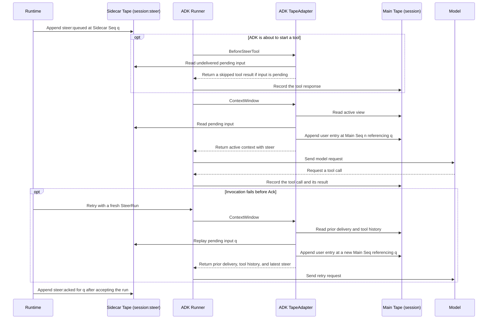

# Steer Inbox and ADK delivery

Steer accepts external text during an ADK invocation and presents it to the
model at the next safe step. The runtime opens a Main Tape and an independent
Sidecar Tape with the same `OwnerID` and different session IDs. Each Tape has
its own sequence of entries. [Sidecar Tape pattern](https://tape.systems/)

## Sidecar Tape

Initialize the Sidecar using the existing Tape storage backend with a distinct
session ID such as `session:steer`. JSONL stores its records under
`{localPathPrefix}/{owner}/{sidecarSessionId}/`. In bbolt, sessions have separate
buckets under the same owner. The current bbolt backend takes an exclusive lock
per file when opening a storage handle. JSONL supports opening both sessions
concurrently under one storage root.

`steer.NewInbox(sidecar *tape.Tape)` binds the runtime's initialized Tape.
`Inbox.Tape()` exposes that Tape for inspection through `OverView` or `Read`
and for lifecycle operations such as `Close`. The runtime shares a single live
storage handle for concurrent access to each Tape and closes it after use.

`Enqueue(ctx, text)` appends a `steer:queued` entry and returns its Sidecar
`Seq` as the message ID. `Pending(ctx)` reads through the observed Sidecar
head, projects new records onto the pending queue, and returns a snapshot
in enqueue order. A new Inbox rebuilds the queue from disk on its first
read. `Ack(ctx, id)` appends a `steer:acked` entry containing the queued ID.
Acknowledgements apply to already queued inputs. Repeating an acknowledgement
has the same effect on pending input.

Enqueue, pending reads, and acknowledgements can run concurrently. A pending
snapshot can race with enqueue or acknowledgement. The backend supplies the
durability guarantees for appends. bbolt commits an append atomically, and
JSONL replay requires complete records. Existing queued and acknowledged
entries retain their format. Reopening an Inbox replays the records in the
supplied Sidecar session. Deployments that previously used a different owner
scope must carry those records into the new session to keep their pending input.

## ADK callbacks

Register `adapter.ContextWindow` after other before-model callbacks that
rewrite model contents. Call `agent.WithSteerInbox(ctx, inbox)` for each
`Runner.Run`, pass the returned context into the runner, and retain its
`SteerRun` handle. When delivering pending input, the adapter checks that
the Sidecar has the Main Tape's owner and uses a separate session.

ADK persists the previous step's tool responses before the next model step.
`ContextWindow` rebuilds `req.Contents` from the active Main Tape view. For
each newly delivered input it appends an `EntryUser` with the steer text,
then adds that text to the current model request. The entry's `steer:session`
extension identifies the Sidecar session and `steer:id` holds the queued
entry's decimal `Seq` string within that session. Later steps in the same
invocation see the entry through the active view. Each pending ID is
delivered once per invocation.

`Delivered()` returns the IDs recorded by that invocation. The runtime
decides when to acknowledge them after accepting the run. A Main Tape append
error aborts the model callback and leaves the input pending. If the runtime
retries before acknowledgement, a fresh invocation appends another user
entry at a new Main Tape `Seq` with the same source reference. Both attempts
and any intervening tool traffic remain on the Main Tape. The retry sees
the earlier attempt and tool traffic when they are in its active view, then
receives the latest delivery at the end of its request.

Register `agent.BeforeSteerTool` as a before-tool callback to return
`{"status":"skipped","reason":"steer_pending"}` when undelivered input is
pending. ADK wraps the result in the matching function response. A tool that
has already passed the callback may finish normally. This hook applies to
tools for which ADK invokes the before-tool callback.
