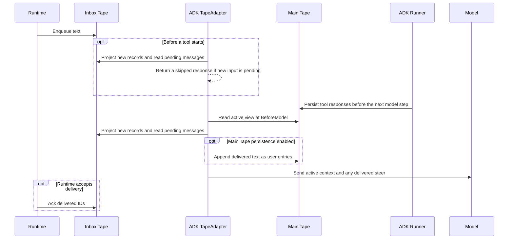

# Steer Inbox and ADK delivery

Steer lets a runtime accept external text while an ADK invocation is in
progress and present it to the model at the next safe step. The runtime
supplies an initialized, independently scoped Tape as the Inbox, following
the [Sidecar Tape pattern](https://tape.systems/). The Inbox uses the
existing `storage.TapeStorage` interface and the caller's backend durability
guarantees. Tape initialization, storage lifecycle, and which logical Tape
serves as the Inbox are deployment choices.

## Inbox

`steer.NewInbox(store, ownerID)` binds the configured Tape session and
owner. `Enqueue(ctx, text)` appends a `steer:queued` entry and returns its
assigned sequence as the message ID. `Pending(ctx)` keeps an in-memory
projection of the last read sequence and the unacknowledged FIFO. It reads
only the new range through the observed head, applies records in sequence
order, and returns a copy of the pending messages. A new Inbox instance
rebuilds that projection on its first read. `Ack(ctx, id)` appends a
`steer:acked` entry for the supplied ID. Callers pass an ID issued by this
Inbox. An acknowledgement removes an already queued message. Repeated
acknowledgements have the same effect as one acknowledgement.

Appends and reads use the backend's concurrency guarantees. Callers share one
live storage handle per Tape and manage its initialization and close outside
concurrent operations. Replay uses persisted records, so unacknowledged input
remains eligible after a process restart and is independent of Main Tape view
changes. A pending read is a snapshot and can race with enqueue or ack.
The bbolt backend commits each append atomically. JSONL replay requires
complete records and inherits the existing file backend's write guarantees.

## ADK callbacks

Register `adapter.ContextWindow` as a before-model callback and call
`agent.WithSteerInbox` for each `Runner.Run` that should receive steer. Pass
its returned context into the runner and retain the returned handle to read
`Delivered()` IDs. Place `ContextWindow` after callbacks that rewrite model
contents. `Delivered()` reports which messages the adapter added to model
requests. The runtime owns completion, acknowledgement, and scheduling.

ADK completes the previous step's tool calls and persists their responses
before starting the next model step. The adapter rebuilds `req.Contents`
from the active Main Tape view and appends newly delivered steer as user
content. Each ID is delivered once per invocation. By default, the steer text
appears only in that model request. `SteerOptions.PersistToTape` also appends
a Main Tape user entry per message so later requests include it when it is in
the active view. If an invocation fails after writing a user entry, the Inbox
item is still pending and may be written again on retry. Runtimes using this
option can scope out failed history when they retry.

Register `agent.BeforeSteerTool` as a before-tool callback to return
`{"status":"skipped","reason":"steer_pending"}` when undelivered input is
pending. ADK wraps the result in the matching function response. A tool that
has already passed this callback may finish normally. This hook applies to
tools for which ADK invokes its before-tool callbacks.
