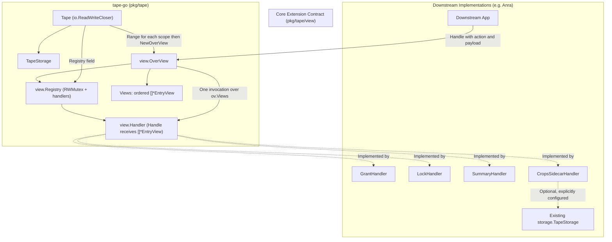

# View Handler Extension Design

## Problem and motivation

In `tape-go`, `view.EntryView` and `view.TapeView` are passive data representations of an entry sequence range `[SeqS, SeqE)`. Downstream systems (e.g., multi-agent collaboration frameworks and contextual tools) frequently need to execute operations directly coupled to a view:
- **Grant**: Issuing authorization leases, borrowing scopes, and validating consumer permissions.
- **Lock / Unlock**: Managing range concurrency, exclusive execution locks, and snapshot isolation.
- **Summary**: Condensing and projecting entries within a view scope into semantic summaries.
- **Sidecar / Crops**: Attaching out-of-band Z-axis records, audit entries, or annotations without consuming the main tape sequence or inflating context.

Currently, `tape-go` lacks a standard view handler binding mechanism, forcing downstream consumers to build bespoke wrappers and duplicate view abstractions.

One operation may need several disjoint entry ranges, such as summarizing
selected portions of a tape together. A handler receives all selected views in
one invocation so it can operate across ranges without filling gaps or losing
each view's metadata.

## Architecture and invariants

1. **Passive view data vs. active OverView**: `view.EntryView` and `view.TapeView` remain lightweight, passive data structures. `view.OverView` holds an ordered collection of `EntryView` pointers and exposes behavioral operations over that collection, resolved through `view.Registry`.
2. **Generic extension protocol**: `tape-go` specifies only the general dispatch mechanism (`Handler`, `Registry`, and `OverView.Handle`). It does not bind or hardcode domain-specific handler schemas (such as grant, lock, or summary payloads), leaving concrete implementations to downstream applications or extension packages.
3. **Reuse existing storage**: This mechanism creates no databases, files, buckets, or persistent handler state. Any downstream handler persistence must reuse existing abstractions and explicitly configured storage; provisioning additional storage requires a separate, explicit instruction. Dispatch itself never appends domain metadata to the main tape sequence.
4. **Stateless registry**: `view.Registry` is a stateless capability dispatcher; stateful or persistent logic is managed internally by individual handlers or external stores.
5. **Context and identity propagation**: All operations pass standard `context.Context`, preserving owner scope, caller identity, timeouts, and cancellations.

## Specification

### 1. Handler contract

```go
package view

import "context"

// Handler defines an executable action over an ordered collection of EntryViews.
type Handler interface {
	// Action returns the unique identifier for this handler.
	Action() string

	// Handle executes one operation against all provided views.
	Handle(ctx context.Context, views []*EntryView, payload any) (any, error)
}
```

### 2. Registry and OverView

A `Registry` registers and resolves handlers by action name:

```go
type Registry struct {
	mu       sync.RWMutex
	handlers map[string]Handler
}

func NewRegistry() *Registry
func (r *Registry) Register(h Handler) error
func (r *Registry) Lookup(action string) (Handler, bool)
```

Registration and lookup are safe to call concurrently. The zero value is usable;
do not copy a registry after first use. `Register` rejects a nil handler, an empty
action, and duplicate actions without replacing the original handler. Actions
are exact, case-sensitive names and must remain stable. The registry lock covers
only map access, never handler execution. Handler implementations are responsible
for their own concurrency safety.

`OverView` binds an ordered collection of `EntryView` pointers to registered handlers:

```go
type OverView struct {
	Views    []*EntryView
	registry *Registry
}

func NewOverView(views []*EntryView, reg *Registry) OverView

// Handle executes action once against the views held by this OverView.
func (ov *OverView) Handle(ctx context.Context, action string, payload any) (any, error)
```

`Handle` returns an error for a missing registry or unknown action. Otherwise it
passes `ov.Views`, the context and payload unchanged to the handler. The handler
runs once for the entire collection, and its result and error are returned
unchanged. The collection belongs to `OverView`; action execution does not accept
additional views. There is no distinguished primary view or combined range.
`NewOverView` retains the provided slice and registry pointer without copying
view or entry data. Callers and handlers must coordinate mutations to shared
data. The handler determines which combinations of views its operation accepts,
including whether an empty collection is valid.

For a manually assembled collection:

```go
ov := view.NewOverView([]*view.EntryView{&first, &second}, registry)
result, err := ov.Handle(ctx, action, payload)
```

Compared with `v0.2.0-anra.4`, handler implementations must change their
`*EntryView` parameter to `[]*EntryView`. Construction changes from
`NewOverView(v, reg)` to `NewOverView([]*EntryView{&v}, reg)`. `OverView` no longer
embeds one `EntryView`; callers access individual view metadata and entries via
`ov.Views[i]`. The promoted `EntryView.MarshalJSON` method no longer applies;
`OverView` uses the default struct JSON encoding. Calls to
`ov.Handle(ctx, action, payload)` keep the same signature for single and multiple
views. These are interface changes; no compatibility wrapper is introduced.

`Tape` exposes a `Registry *view.Registry` field, configured before use, and
provides a helper accessor:

```go
func (t *Tape) OverView(ctx context.Context, scopes ...view.EntryRange) (view.OverView, error)
```

The helper calls the existing storage `Range(ctx, scope)` for each scope in
caller order, then constructs one `OverView` containing all returned views.
Ranges are not merged, sorted, or deduplicated. A single range remains a valid
call; a slice of ranges can be passed using `scopes...`. With no ranges, the
helper returns an empty collection without reading storage. The caller supplies
the owner scope through `ctx`, as with `Range` and `Find`; `OwnerID` does not
replace that context. Nil storage returns an error. A range error stops further
reads and returns a zero `OverView` and the original error, without a partial
collection. The helper does not alter `Tape.View` or the I/O read position. A nil
registry permits loading the views, but dispatch then returns an error. No global
registry is introduced.

## Design diagram


